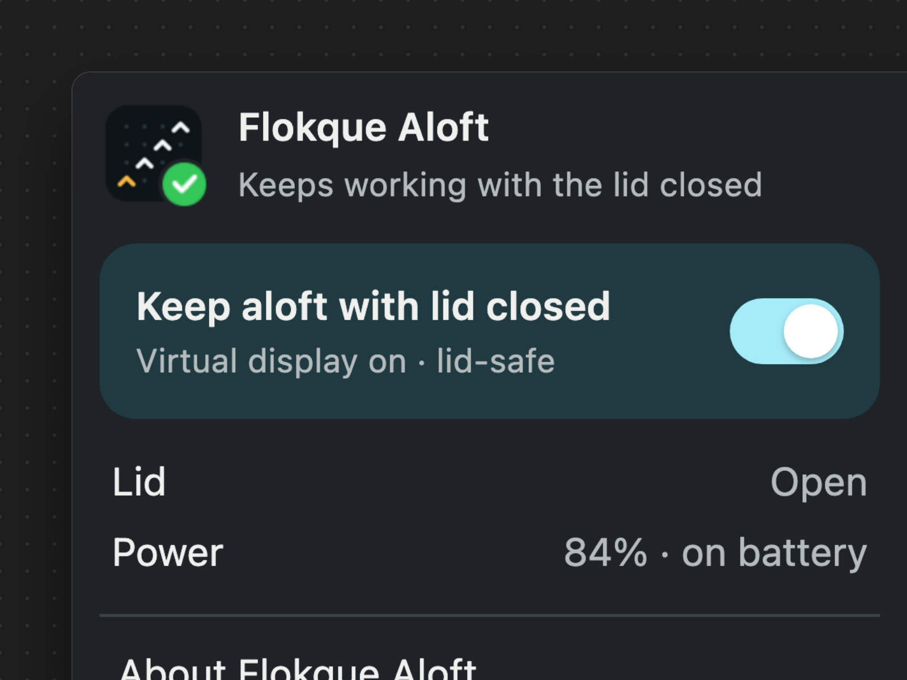
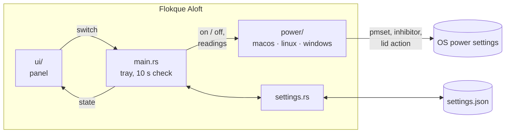

# Flokque Aloft

<p align="center"><a href="https://preacherxp.github.io/30-days-of-tools/"></a></p>

<p align="center"><a href="https://buymeacoffee.com/michal.hachula"></a></p>

A menu bar and tray app for macOS, Linux and Windows that keeps your computer working with its lid closed, so long-running work (coding agents, builds, downloads) carries on in a bag.

Flip **Keep aloft with lid closed** in its panel or its tray menu, close the lid, and the computer stays awake. Quit, and sleep comes back. If the computer gets too hot or the battery runs low, it turns itself off.

<p align="center"></p>

- **Close the lid, keep working.** Agents, builds and downloads carry on in your bag.
- **One switch.** Turn it on from the menu bar; quit, and sleep comes back.
- **Safe by default.** It turns itself off when it's too hot or the battery runs low.
- **Mac, Linux and Windows.** One small app, the same panel everywhere.

## Requirements

- macOS 14 or later, Linux with systemd-logind, or Windows
- Rust and the Tauri 2 CLI to build it: `cargo install tauri-cli --version '^2' --locked`
- On Linux, the [Tauri prerequisites](https://tauri.app/start/prerequisites/#linux) to build it (WebKitGTK 4.1 and an AppIndicator library)

## Install

There are no prebuilt releases yet. Build it on the platform you'll run it on; there is no cross-compiling.

```sh
git clone https://github.com/preacherxp/flokque-aloft.git
cd flokque-aloft
cargo tauri build
```

The bundles land in `target/release/bundle/`: `.app` and `.dmg` on macOS, `.deb`, `.rpm` and AppImage on Linux, `.msi` and setup `.exe` on Windows. Install the one for your system. On macOS, `cargo tauri build --bundles app` builds just the app; move `target/release/bundle/macos/Flokque Aloft.app` to `/Applications`.

The first time you turn it on, macOS asks for an administrator password to install `/etc/sudoers.d/flokque-aloft`, which allows only `pmset -a disablesleep 0|1`.

To start Aloft at login, add it to your login items (macOS), autostart (Linux) or startup apps (Windows).

To update, `git pull`, build again and reinstall. To uninstall, quit Aloft, which restores sleep, then delete the app. On macOS, also remove the sudoers rule:

```sh
sudo rm /etc/sudoers.d/flokque-aloft
```

## Usage

Click the menu bar or tray icon to open the panel, and flip **Keep aloft with lid closed**. The icon changes while it's on, and the panel shows the lid and power state. Most Linux trays only show the tray menu; **Show Flokque Aloft** in it opens the panel.

Aloft turns itself off when the computer overheats (macOS and Linux) or, on battery, drops below 20%. If it was on when you quit, it turns back on the next time it starts.

## Configuration

`settings.json` in the app's config directory: `~/Library/Application Support/com.flokque.aloft/` on macOS, `~/.config/com.flokque.aloft/` on Linux, and `%APPDATA%\com.flokque.aloft\` on Windows. Aloft reads it every 10 seconds.

```json
{
  "on": false,
  "minBattery": 20,
  "flokqueUrl": "http://127.0.0.1:4820"
}
```

- `on` is whether Aloft is keeping the computer awake. The switch writes it.
- `minBattery` is the charge, in percent, below which it turns itself off on battery.
- `flokqueUrl` is where to find Flokque if it runs on this computer. When it does, the panel shows its running agents.

## Limits

- Overheat protection and the lid state work on macOS and Linux only.
- On Linux it needs systemd-logind, and polkit has to let the active session hold a sleep inhibitor, which logind's default policy does.
- On macOS the virtual display uses a private CoreGraphics API. If it isn't available, the panel says **Lid-safe · virtual display unavailable**.

## Architecture



- **`src/main.rs`** runs the tray icon and menu and the panel window. Every 10 seconds it reads the battery, lid and temperature, and turns Aloft off when it's unsafe to stay awake.
- **`ui/`** is the panel, plain HTML, CSS and JavaScript talking to the app through Tauri.
- **`src/settings.rs`** reads and writes `settings.json` on every check, so edits take effect within seconds.
- **`src/power/`** does the platform work. What each one changes:
  - **macOS** sets `pmset -a disablesleep 1`, holds an idle-sleep assertion, and adds a 1920×1080 virtual display that mirrors the screen, so no window opens on it. Turning it off sets `disablesleep 0`.
  - **Linux** holds a systemd-logind block inhibitor on sleep, idle and the lid switch (`systemd-inhibit`). It ends with Aloft, even if Aloft crashes.
  - **Windows** sets the power plan's lid close action to *Do nothing* and asks Windows to stay awake. It puts the lid action back when it's turned off, and on the next start if Aloft didn't quit properly.

## Development

```sh
cargo tauri dev                    # run it
cargo test                         # the parsers and safety checks
cargo clippy --all-targets -- -D warnings
cargo tauri icon icons/icon.png    # the bundle icons, from the app icon on the macOS grid
```

CI runs `cargo fmt --check`, clippy and the tests on macOS, Linux and Windows.

## License

[MIT](LICENSE)

<sub>If it keeps your work running with the lid closed, you can [buy me a coffee](https://buymeacoffee.com/michal.hachula).</sub>
