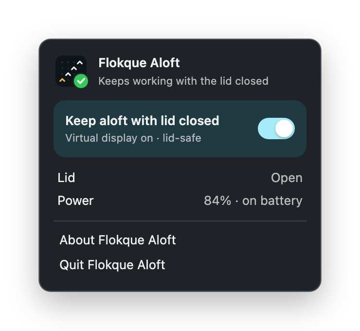

# Flokque Aloft

<p align="center"><a href="https://buymeacoffee.com/michal.hachula"></a></p>

A menu bar and tray app for macOS, Linux and Windows that keeps your computer
working with its lid closed, so long-running work (coding agents, builds,
downloads) carries on in a bag. Flip **Keep aloft with lid closed** in its
panel, or in its tray menu.

<p align="center"></p>

- **Close the lid, keep working.** Agents, builds and downloads carry on in your bag.
- **One switch.** Turn it on from the menu bar; quit, and sleep comes back.
- **Safe by default.** It turns itself off when it's too hot or the battery runs low.
- **Mac, Linux and Windows.** One small app, the same panel everywhere.

## How it works

- **macOS** (14+) sets `pmset -a disablesleep 1`, holds an idle-sleep
  assertion, and adds a 1920×1080 virtual display that mirrors the screen (so
  no window opens on it). The first time, macOS asks for an administrator
  password to install `/etc/sudoers.d/flokque-aloft`, which allows only
  `pmset -a disablesleep 0|1`.
- **Linux** holds a systemd-logind block inhibitor on sleep, idle and the lid
  switch (`systemd-inhibit`), which logind's polkit policy allows for the
  active session. Most Linux trays only show the tray menu; **Show Flokque
  Aloft** in it opens the panel.
- **Windows** sets the power plan's lid close action to *Do nothing* and asks
  Windows to stay awake. It puts the lid action back when it's turned off,
  and on the next start if Aloft didn't quit properly.

Quitting restores sleep. Aloft turns itself off when the computer overheats
(macOS and Linux) or, on battery, drops below 20%. The lid state shows where
the system reports it (macOS and Linux).

## Settings

`settings.json` in the app's config directory: `~/Library/Application
Support/com.flokque.aloft/` on macOS, `~/.config/com.flokque.aloft/` on Linux,
and `%APPDATA%\com.flokque.aloft\` on Windows. Aloft reads it every 10 seconds.

```json
{
  "on": false,
  "minBattery": 20
}
```

## Building

Aloft is a [Tauri 2](https://tauri.app) app. It needs Rust, the Tauri CLI
(`cargo install tauri-cli --version '^2' --locked`), and on Linux the
[Tauri prerequisites](https://tauri.app/start/prerequisites/#linux)
(WebKitGTK 4.1 and an AppIndicator library).

```sh
cd aloft
cargo tauri dev                    # run it
cargo test                         # the parsers and safety checks
cargo tauri build                  # .app and .dmg, .deb, .rpm and AppImage, or .msi and setup .exe
cargo tauri build --bundles app    # just the .app
cargo tauri icon icons/icon.png    # the bundle icons, from the app icon on the macOS grid
```

Each platform builds its own bundles; there is no cross-compiling. To start
Aloft at login, add it to your login items (macOS), autostart (Linux) or
startup apps (Windows).

## License

[MIT](LICENSE)

<sub>If it keeps your work running with the lid closed, you can [buy me a coffee](https://buymeacoffee.com/michal.hachula).</sub>
